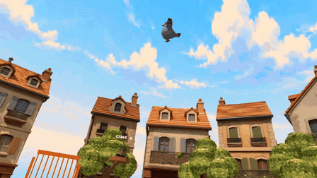
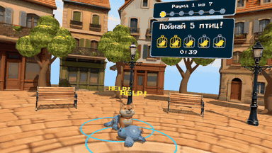
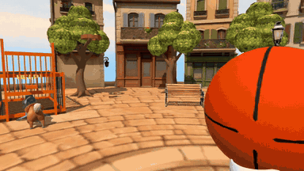
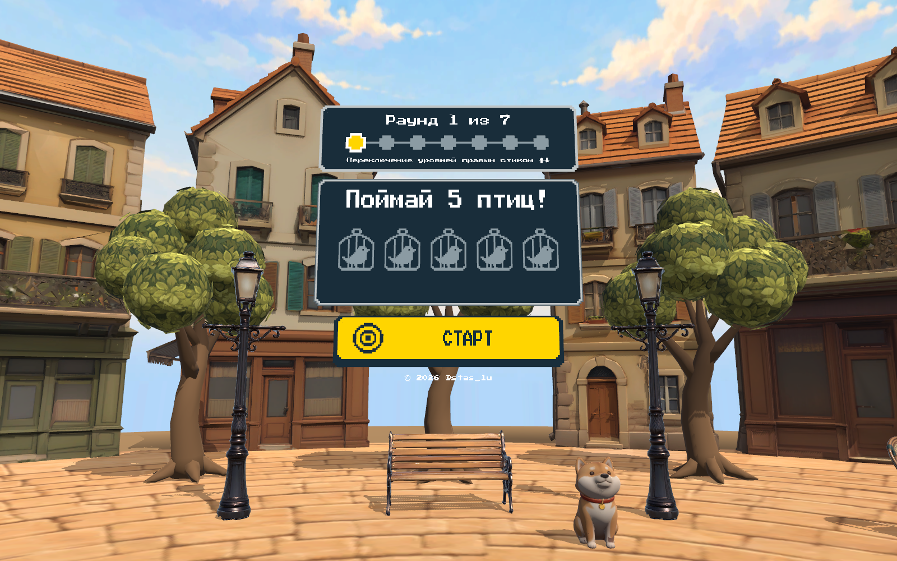
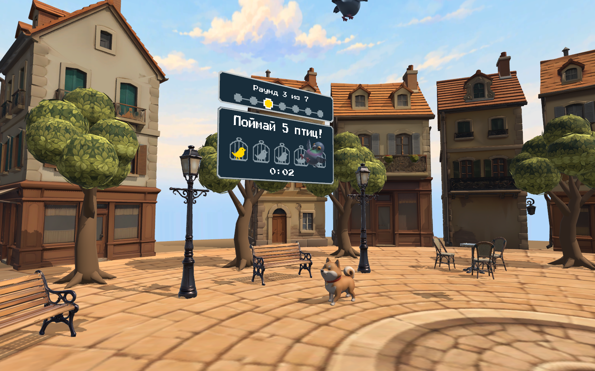
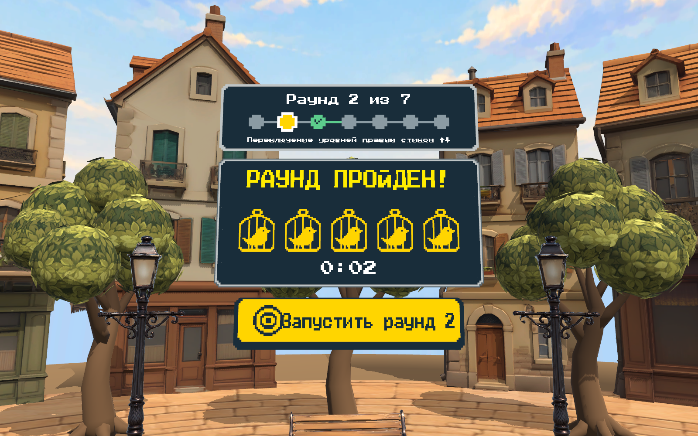

# Охота

**Демо · тестовая версия 1.0.** Аркада для VR-шлема. Сбивай голубей мячом, пока пёс собирает их в клетки. В следующих раундах появляются охранники. Они спасают сбитых птиц, сбрасывают яйца с парашютами и могут открыть клетку.

## Геймплей



[Смотреть геймплей со звуком (24 секунды, MP4)](media/gameplay.mp4)

**Пёс подбирает голубя**



**Охранник сбрасывает яйцо с парашютом**



## Как играть

1. Возьми мяч со стойки курком и брось в жёлтую мишень **«СТАРТ»**.
2. Сбей пять птиц и помоги псу отнести их в клетки. Яйца охранников можно сбивать мячом.
3. До старта и после победы правый стик **вверх или вниз** выбирает один из семи раундов. Попади в мишень под табло, чтобы начать выбранный раунд. Можно вернуться к уже пройденному.

| Действие | Управление |
| --- | --- |
| Взять и бросить мяч | Удерживай курок рядом с мячом. Отпусти курок во время броска. |
| Повернуться на 90° | Правый стик влево или вправо |
| Выбрать раунд | Правый стик вверх или вниз до старта и после победы |
| Отцентрировать вид | B на правом контроллере |







## Скачать и установить

Для установки нужен VR-шлем с поддержкой установки APK через ADB. Для игры нужны два контроллера.

**[Скачать APK тестовой версии](https://github.com/nookinvest-ops/shar-udar/releases/download/v1.0.0/Ohota.apk)** · [Страница релиза](https://github.com/nookinvest-ops/shar-udar/releases/tag/v1.0.0)

1. Включи режим разработчика и USB-отладку по инструкции для своего VR-шлема. Подключи шлем к компьютеру кабелем USB с передачей данных и подтверди запрос отладки в шлеме.
2. Установи [Android SDK Platform-Tools](https://developer.android.com/tools/releases/platform-tools). Открой терминал в папке с APK и выполни:

   ```sh
   adb install -r Ohota.apk
   ```

3. Найди **«Охота»** в библиотеке приложений VR-шлема. Игра может появиться в разделе **«Неизвестные источники»**.

© 2026 @stas_lu · [Авторы и лицензии ресурсов](THIRD_PARTY_NOTICES.txt)
